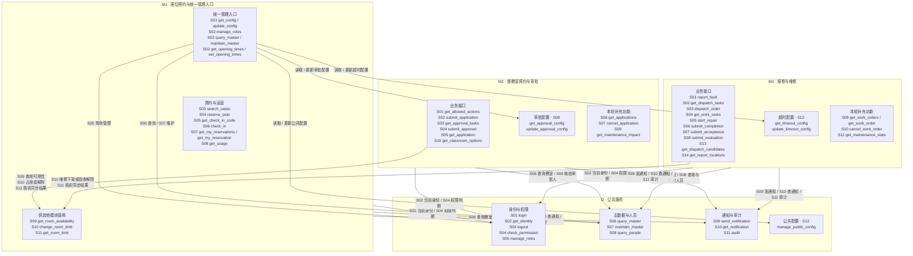

# 四模块接口关系图

箭头表示调用方 → 服务提供方。框内按服务编号列出函数；全部56个函数均为本版必做。图中是当前约定，业务尚未实现。

M2与M3不直接互调：教室的审批占用、维修限制统一通过M1协调。图中的小框仅用于归类公开接口，不规定内部实现。

所有业务接口使用 `POST /api/v1/{模块}/{函数名}`；模块路径为 `d`、`m1`、`m2`、`m3`。输入输出以 [D](planning/R1/Module_D/D.md)、[M1](planning/R1/Module_M1/M1.md)、[M2](planning/R1/Module_M2/M2.md)、[M3](planning/R1/Module_M3/M3.md) 文档为准，公共规则见[开发指导](开发指导.md)。修改公开接口时同步更新本图。
